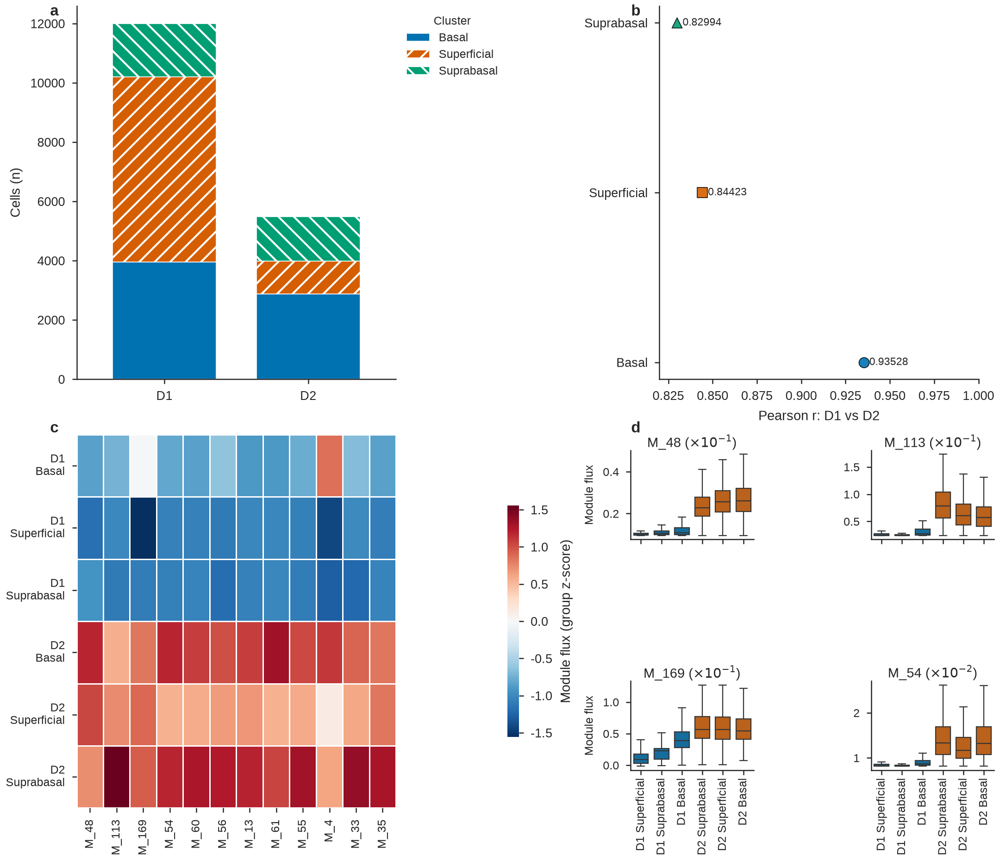
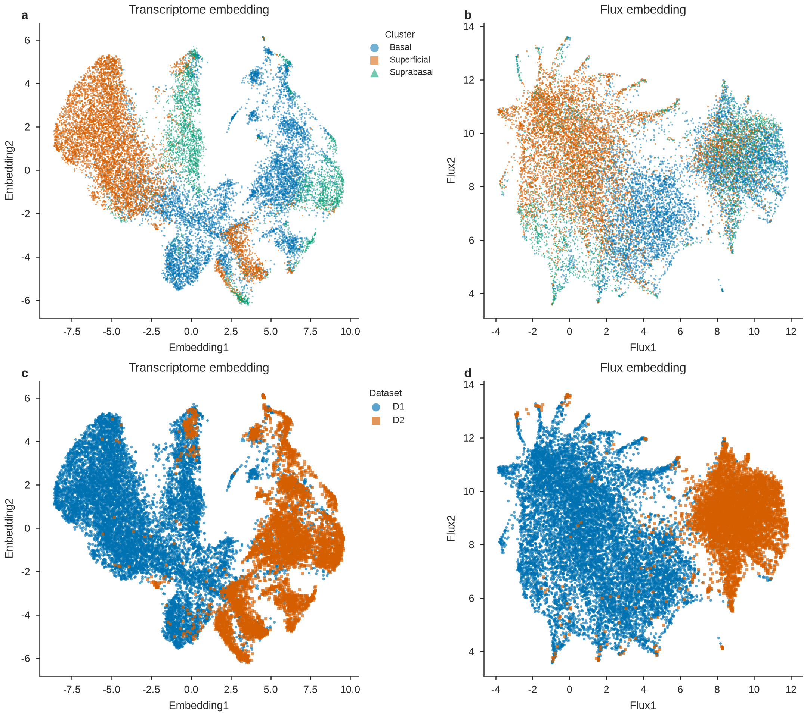
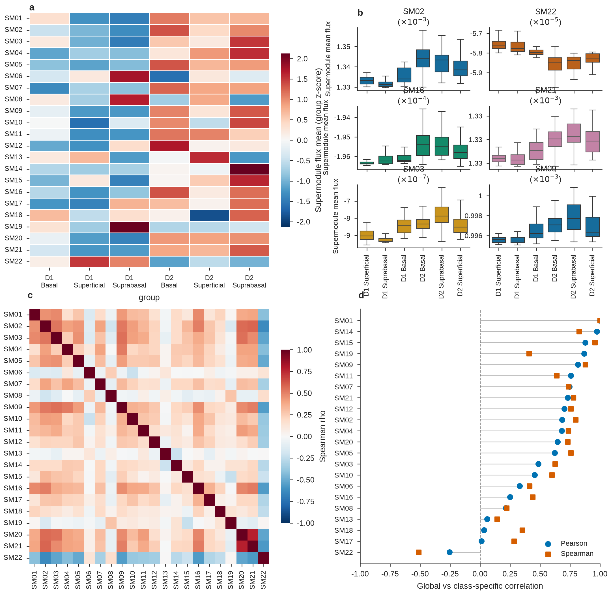
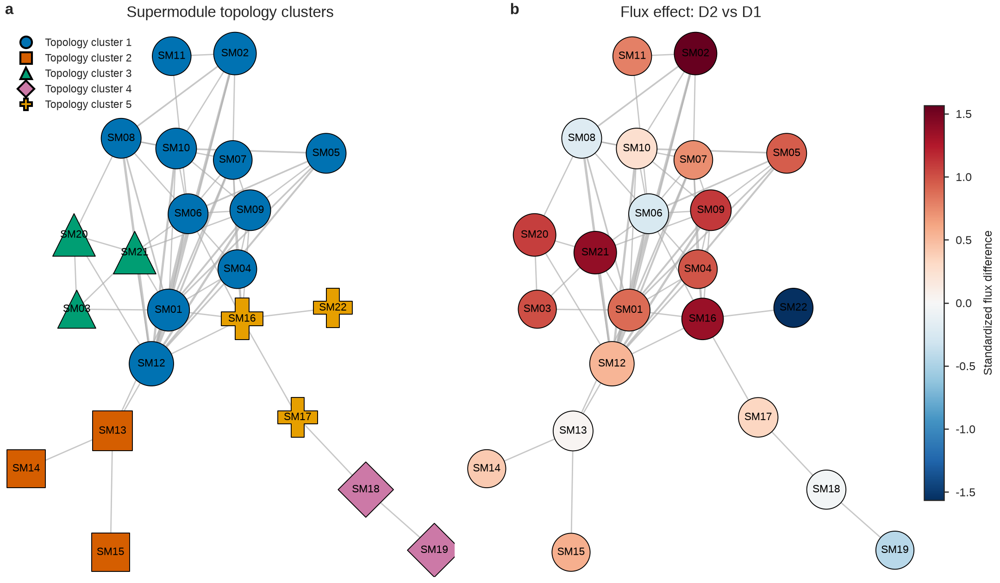
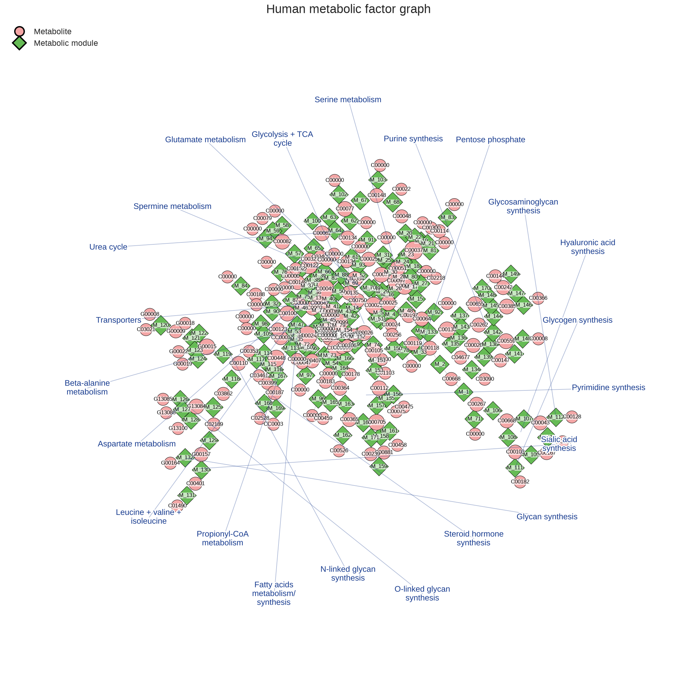

# scFEAann

`scFEAann` packages the supplied scFEA algorithms behind an AnnData API. It
keeps the original FLUX network, loss terms, Adam optimizer, learning rate,
random seed, training epochs, flux inference, and per-cell gene-to-module
gradient calculation. The package replaces CSV input/output with AnnData
matrix selection and result storage.

See [`figure.md`](figure.md) for the complete figure/table tutorial, CLI
recipes, API signatures, previews, workbook contents, and network exports.

## At a glance

| Capability | Main output |
|---|---|
| Global scFEA | `obsm["scFEA_flux"]`, `obsm["scFEA_balance"]` |
| Gradient analysis | `obsm["scFEA_grad"]` |
| 22 supermodule submodels | `obsm["scFEA_supermodule_flux_mean/sum"]` |
| SCI-style report | Figures 1–5, supplementary figures, workbook, source data |
| Network analysis | 22-node supermodule graph and full metabolic factor graph |
| Module interpretation | Reactions, KEGG IDs, member genes, supermodule IDs |

## Install

```bash
uv venv --python 3.12
uv sync --dev
```

The uv configuration uses the PyTorch CPU index so development works on
machines without CUDA. To use an existing CUDA-enabled torch installation,
install torch from the matching CUDA index before running `scFEAann`, or
remove the explicit PyTorch index from `pyproject.toml`.

MAGIC imputation is optional:

```bash
uv sync --extra magic
```

`sc_imputation=True` raises an actionable `ImportError` if the optional
package is unavailable.

## Quick start

```python
import anndata as ad
import scFEAann

adata = ad.read_h5ad("input.h5ad")

scFEAann.run_scfeaann(
    adata,
    group_key="cell_type",  # selected from adata.obs
    epochs=100,
    device="auto",
)

adata.write_h5ad("output_with_flux.h5ad")
```

`run_scfeaann` updates `adata` in place by default and returns that same object.
Use `copy=True` to leave the input unchanged:

```python
result = scFEAann.run_scfeaann(adata, group_key="cell_type", copy=True)
```

## The two APIs

### Flux and compound balance

```python
scFEAann.run_scfeaann(adata, ...)
```

This corresponds to the original `src/scFEA.py` workflow. It trains the global
scFEA model and returns:

```python
adata.obsm["scFEA_flux"]       # n_obs x n_modules
adata.obsm["scFEA_balance"]    # n_obs x n_compounds
```

### Gene-to-module gradient

```python
scFEAann.calculate_scfeaann_gradient(adata, ...)
```

This corresponds to the original `src/scFEA_grad.py` workflow. It performs its
own training and then refits each cell to calculate gradients. It does not
require a prior `run_scfeaann` call and does not replace existing flux results.

The gradient is stored in a form suitable for HDF5 persistence:

```python
adata.obsm["scFEA_grad"]  # n_obs x (n_genes * n_modules)
```

Use the helper to restore its structure:

```python
one_cell = scFEAann.get_scfeaann_gradient(adata, cell="cell_001")
# DataFrame: gradient genes x modules

all_cells = scFEAann.get_scfeaann_gradient(adata)
# ndarray: n_obs x gradient genes x modules
```

Gradient flattening uses C-order over `(cells, genes, modules)`: gene is the
outer axis and module is the inner axis.

The gradient calculation is substantially more expensive than flux inference.
Its result also follows the original scFEA normalization, so entries where the
selected expression is zero divided by itself can be `NaN`.

## Expression source

The default expression source is `adata.X`. The observation axis must be cells
and the variable axis must be genes.

```python
# Default
scFEAann.run_scfeaann(adata)

# A named layer
scFEAann.run_scfeaann(adata, layer="counts")

# Raw data and raw gene names
scFEAann.run_scfeaann(adata, use_raw=True)
```

`layer` and `use_raw=True` are mutually exclusive. Every source must have shape
`n_obs x n_vars`. Observation and variable names must be unique.

The adapter does not modify the chosen expression matrix. It applies the
original scFEA preprocessing order:

1. Optional MAGIC imputation on the complete source matrix.
2. `log2(x + 1)` when the maximum value exceeds 50.
3. Gene-scale normalization using all source genes.
4. Selection of genes shared with the module file.
5. Lexicographic sorting of overlap genes.
6. Construction of one masked gene block per metabolic module.

## Grouping

`group_key` is optional. When supplied, it must name a column in `adata.obs`.
The values are preserved unchanged and the key is recorded under
`adata.uns["scFEAann"]["group_key"]`.

Groups do not split training. All cells are fitted as one global batch, matching
the supplied scFEA implementation. Use `obs` grouping for downstream
visualization or statistics after fitting.

Arbitrary dataset and cluster names are supported. Known corneal labels receive
compact figure labels; unknown labels remain unchanged when short enough, and
long labels receive unique truncated variants to prevent accidental category
merging.

### Two-level grouping

The original scFEA algorithm does not read grouping columns and does not train
separate models per group. To describe nested grouping while preserving one
global model, create a composite observation column:

```python
adata.obs["dataset_cluster"] = (
    adata.obs["dataset"].astype(str)
    + " | "
    + adata.obs["cluster"].astype(str)
)

scFEAann.run_scfeaann(adata, group_key="dataset_cluster")
```

The original `dataset` and `cluster` columns remain available for
`obs.groupby(["dataset", "cluster"])`. This is metadata-level nested grouping,
not dataset-by-dataset or cluster-by-cluster model fitting.

If separate models are scientifically required, subset AnnData and invoke the
API once per subset. Those models are no longer the single native scFEA fit and
their results should be interpreted as separate analyses.

## Test-data workflow

[examples/scfeaann_testdata_flow.py](examples/scfeaann_testdata_flow.py) reads
`testdata/testdata.h5ad` in backed mode, preserves `dataset` and `cluster`,
creates `dataset_cluster`, runs one global model, and saves a new H5AD.

A deterministic stratified smoke run:

```bash
.venv/bin/python examples/scfeaann_testdata_flow.py \
  --output outputs/testdata_scfeaann_sample.h5ad \
  --max-cells 200 \
  --epochs 1
```

The same flow on all 17,492 cells:

```bash
.venv/bin/python examples/scfeaann_testdata_flow.py \
  --output outputs/testdata_scfeaann_full.h5ad \
  --max-cells 0 \
  --epochs 1
```

Add `--gradient` to calculate the more expensive gene-to-module gradient. Use
`--epochs 100` for the original analysis setting. `--dataset D1` or
`--dataset D2` restricts the run to one dataset without splitting the remaining
cells into separate models.

### Run every example

[examples/run_all_examples.sh](examples/run_all_examples.sh) runs the examples
in dependency order: global flux, all 22 supermodule models, the SCI report,
and the performance benchmark. Its defaults use all 17,492 cells and
100 epochs:

```bash
examples/run_all_examples.sh
```

This is intentionally a long validation run. Check the generated commands
without creating files or starting training:

```bash
examples/run_all_examples.sh --dry-run
```

A fast end-to-end smoke test:

```bash
examples/run_all_examples.sh \
  --output-dir /tmp/scfeaann_examples_smoke \
  --max-cells 10 \
  --epochs 1 \
  --device cpu \
  --benchmark-repeats 1
```

The default output directory is `outputs/examples_full_100ep`. It contains:

| Path | Contents |
|---|---|
| `global_scfeaann.h5ad` | Full-cell global flux and balance |
| `supermodule_scfeaann.h5ad` | Global model plus 22 independent class models |
| `report/` | Figures, workbook, source data, and report manifest |
| `benchmark.json` | Timing and memory benchmark |
| `logs/<stage>.log` | Complete stdout and stderr for each stage |
| `run_summary.tsv` | Stage status, timestamps, duration, and artifact |
| `environment.txt` | Resolved parameters and Python version |

Use `--resume` to skip stages whose expected artifact already exists. Use
`--skip-benchmark` to omit the extra global training run, and
`--with-gradient` only when the expensive per-cell refitting analysis is
required. For a partial `--classes` run, the report uses
`global_scfeaann.h5ad`; an all-class run reports directly from
`supermodule_scfeaann.h5ad`. Matplotlib, Fontconfig, and Numba caches are kept
inside the output directory.

## SCI-style figures and tables

Generate a complete English SCI-style report from a result H5AD:

```bash
MPLCONFIGDIR=/tmp/matplotlib-cache \
.venv/bin/python examples/scfeaann_report.py \
  --input outputs/testdata_scfeaann_full_100ep.h5ad \
  --output-dir outputs/report_100ep \
  --embedding-method umap \
  --dpi 300
```

The report contains:

- `Fig1`: dataset-cluster composition, cross-dataset consistency, module-flux
  heatmap, and top-module distributions.
- `Fig2`: compound-balance heatmap, top-compound distributions, and module/compound
  between-group effect rankings.
- `Fig3`: transcriptome and flux embeddings colored by cluster and dataset.
- `Fig4`: supermodule heatmap, distributions, class correlation, and
  global-versus-class agreement.
- `Fig5`: 22-node supermodule network with topology clusters and flux effect.
- `Supp_Fig_loss`: all five loss components across training epochs.
- `Supp_Fig2_supermodules`: supermodule PCA and representative model comparisons.
- `Supp_Fig3_metabolic_network`: full module–metabolite factor graph.
- `report_tables.xlsx`: grouped statistics, consistency, feature rankings, and
  loss history.
- Compressed cell-level flux, balance, and metadata tables.
- `figure_source_data/`: the exact data behind every figure panel.
- Supermodule and network node/edge/layout tables.
- `report_manifest.json`: grouping, features, embeddings, file inventory, and
  software versions.

Every figure is exported as PDF, SVG, PNG at 300 dpi, and grayscale PNG. The
main figures use a 7.2-inch double-column width, colorblind-safe colors,
redundant marker/hatch encodings, and an internal layout audit for missing
glyphs, clipped labels, and overlapping tick labels.

The report intentionally omits cell-level p-values. With thousands of cells and
two datasets, cells are not independent biological replicates. The workbook
provides descriptive group statistics and effect rankings instead.

## Figure previews

### Global flux and balance





### Supermodule models



### Networks





The supermodule previews above use a 200-cell, one-epoch validation result to
demonstrate layout and file generation. Use a converged full-cell H5AD for
final biological interpretation.

## Module annotation

Human module IDs are mapped to reactions with:

```python
from scFEAann import get_module_annotation

annotation = get_module_annotation()
annotation.loc[
    ["M_1", "M_48", "M_77"],
    [
        "reaction",
        "input_names",
        "input_kegg_ids",
        "output_names",
        "output_kegg_ids",
        "supermodule_id",
        "module_genes",
    ],
]
```

Examples:

| Module | Reaction | Supermodule |
|---|---|---:|
| `M_1` | Glucose -> G6P | 1 |
| `M_48` | Glutamate -> Glutamine | 8 |
| `M_77` | Oxaloacetate_in -> Oxaloacetate | 12 |

The human model contains 168 modules numbered `M_1` through `M_171`; IDs
`M_82`, `M_86`, and `M_104` are absent, so module numbers are not a dense
1-to-168 sequence. The annotation is validated against the signed stoichiometry
matrix: negative coefficients are inputs and positive coefficients are outputs.

Some reaction participants use external/boundary identifiers such as `C00000`
or compounds outside the 70-compound balance matrix. Those names remain in the
annotation and are listed in `unmodeled_reference_ids`; flux can still be
estimated for the module even when every participant is not represented in the
balance vector. `Supermodule_id` is the only supermodule naming available in the
provided files; the repository does not include an official mapping from those
numeric IDs to pathway names.

Every report writes the complete mapping to `module_annotation.csv` and the
`module_annotation` sheet of `report_tables.xlsx`.

## Supermodule-specific models

The global model and independently trained supermodule models can be produced
in one call:

```python
import scFEAann

scFEAann.run_scfeaann_supermodules(
    adata,
    classes=None,          # all 22 classes
    include_total=True,    # also train the standard 168-module model
    group_key="dataset_cluster",
    epochs=100,
)
```

Per-class models are independent submodels, not slices of the global model.
Every class keeps all 70 compound axes and trains on all cells. Four classes
contain only one module (`3`, `14`, `15`, and `19`); their mathematically
undefined module-correlation loss is disabled and recorded in metadata.

Results include:

```python
obsm["scFEA_flux"]                    # global 168-module result
obsm["scFEA_balance"]                 # global 70-compound result
obsm["scFEA_supermodule_flux"]        # assembled class-specific modules
obsm["scFEA_supermodule_balance"]     # 22 classes x 70 compounds, flattened
obsm["scFEA_supermodule_flux_sum"]    # 22 class node features
obsm["scFEA_supermodule_flux_mean"]   # 22 class node features
```

When `export_scfeaann_report()` detects these result keys, it automatically
adds:

- `Fig4`: supermodule group heatmap, top-class distributions, class correlation,
  and global-versus-class model agreement.
- `Supp_Fig2_supermodules`: PCA of the 22 class features and representative
  model comparisons.
- `supermodule_group_summary`, `supermodule_effects`,
  `supermodule_model_agreement`, `supermodule_correlation`, and
  `supermodule_annotation` workbook sheets.
- Per-cell and per-group network node features.

Main figures use `flux_mean`; both `flux_mean` and `flux_sum` are retained in
the node tables.

## Performance and memory controls

`prediction_batch_size` controls inference only. The network, loss, Adam
optimizer, original full-cell training behavior, and random seed are unchanged.
Its default is `1024`:

```python
scFEAann.run_scfeaann(
    adata,
    prediction_batch_size=1024,
)

scFEAann.run_scfeaann_supermodules(
    adata,
    include_total=True,
    prediction_batch_size=1024,
)
```

The effective batch is stored in
`uns["scFEAann"]["parameters"]["prediction_batch_size"]` for the global model
and in each `class_results[class_id]["parameters"]` record. Batched and
one-cell inference are numerically equivalent up to float32 execution-order
rounding.

Sparse non-MAGIC input takes a sparse fast path: finite-value checks,
log transformation, and row sums operate on sparse storage, and only genes in
the scFEA module vocabulary are densified. MAGIC still requires the original
dense preprocessing path.

When `include_total=False`, the run does not allocate the full
`n_cells × 168 × n_overlap_genes` tensor. It retains the shared gene expression
and materializes only the requested class blocks. With `include_total=True`,
the full tensor is released after global training and result writing, then
each supermodule class is built on demand. The persisted class-level result
matrices still occupy memory and H5AD space.

The benchmark below uses a deterministic 1,000-cell sample from
`testdata/testdata.h5ad`, one epoch, CPU Torch, and three timed inference
repeats. Full JSON and environment details are in
[benchmark_testdata_1000.json](outputs/benchmark_testdata_1000.json).

| Measurement | Result |
|---|---:|
| Overlap genes | 661 |
| Full module tensor | 423.6 MiB |
| Representative class tensor (14 modules) | 35.3 MiB |
| Full preprocessing | 0.230 s |
| Deferred preprocessing | 0.201 s |
| Inference, batch 1 | 68.7 cells/s |
| Inference, batch 64 | 2,464 cells/s |
| Inference, batch 1024 | 4,235 cells/s |

Run the same benchmark locally:

```bash
MPLCONFIGDIR=/tmp/scfeaann-mpl \
.venv/bin/python examples/scfeaann_benchmark.py \
  --max-cells 1000 \
  --epochs 1 \
  --prediction-batch-sizes 1,64,1024 \
  --repeats 3 \
  --output-json outputs/benchmark_testdata_1000.json
```

Use `--max-cells 0` only after confirming that enough RAM is available. The
benchmark reports stage timing, current/peak RSS, and calculated tensor sizes;
machine load and CPU/GPU choice affect absolute timings.

## Network construction

Two network views can be built directly from the current model and AnnData:

```python
from scFEAann.reporting import (
    build_supermodule_network,
    build_factor_graph,
    plot_supermodule_network,
    plot_factor_graph,
    write_network_tables,
)

network = build_supermodule_network(
    adata,
    contrast_key="dataset",
    contrast=("D1", "D2"),
)
factor_graph = build_factor_graph()

plot_supermodule_network(network, "outputs/network")
plot_factor_graph(factor_graph, "outputs/network")
write_network_tables(network, factor_graph, "outputs/network")
```

The 22-node network connects supermodule classes sharing annotated metabolites.
The complete factor graph connects 168 modules to their input/output compounds.
Topology comes from model annotation; AnnData contributes flux/effect node
attributes.

Generated network tables:

| File | Contents |
|---|---|
| `network_nodes.csv` | Supermodule node attributes and contrast effects |
| `network_edges.csv` | Shared compounds and edge weights |
| `network_layout.csv` | Reproducible Kamada–Kawai coordinates |
| `network_supermodule_summary.csv` | Network-ready class summary |
| `factor_graph_nodes.csv` | Module/compound labels and KEGG IDs |
| `factor_graph_edges.csv` | Module–compound directions |
| `factor_graph_layout.csv` | Full graph coordinates |
| `factor_graph_supermodule_labels.csv` | Blue supermodule annotation positions |

`export_scfeaann_report()` integrates all network files automatically when
supermodule results are present. Set `network_contrast_key` and
`network_contrast` to choose a different comparison.

## Table examples

Group counts:

| dataset | cluster | n_cells |
|---|---|---:|
| D1 | basal epithelium | 3954 |
| D1 | superficial epithelium | 6246 |
| D1 | suprabasal epithelial cells | 1800 |
| D2 | basal epithelium | 2876 |
| D2 | superficial epithelium | 1106 |
| D2 | suprabasal epithelial cells | 1510 |

Dataset consistency:

| cluster | Pearson r | Spearman rho |
|---|---:|---:|
| Basal | 0.9353 | 0.9402 |
| Superficial | 0.8442 | 0.9426 |
| Suprabasal | 0.8299 | 0.9303 |

Top module-level group effects:

| module | reaction | effect ratio |
|---|---|---:|
| M_48 | Glutamate -> Glutamine | 0.530 |
| M_113 | Acetyl-CoA -> (E,E)-Farnesyl-PP | 0.488 |
| M_169 | Cholesterol -> Steroid_hormone | 0.471 |
| M_54 | Valine -> Succinyl-CoA | 0.444 |

The complete tables are in [report_tables.xlsx](outputs/report_100ep/report_tables.xlsx)
and [module_annotation.csv](outputs/report_100ep/module_annotation.csv).

## Shared parameters

The flux and gradient APIs share the input and model options below.
`prediction_batch_size` applies only to flux inference in `run_scfeaann` and
`run_scfeaann_supermodules`:

| Parameter | Default | Meaning |
|---|---|---|
| `group_key` | `None` | Optional, metadata-only `obs` grouping column |
| `layer` | `None` | Use `adata.layers[layer]`; default is `adata.X` |
| `use_raw` | `False` | Use `adata.raw.X` and `adata.raw.var_names` |
| `sc_imputation` | `False` | Apply MAGIC before other preprocessing |
| `epochs` | `100` | Global training epochs |
| `device` | `"auto"` | Torch device, for example `"cpu"` or `"cuda:0"` |
| `data_dir` | packaged data | Directory containing model CSV files |
| `module_gene_file` | human M168 | Module-to-gene CSV filename |
| `stoichiometry_matrix` | human C70/M168 | Compound-to-module CSV filename |
| `compound_name_file` | human C70/M168 | Compound-name CSV filename |
| `copy` | `False` | Update and return input, or operate on a copy |
| `verbose` | `True` | Show training and gradient progress |
| `prediction_batch_size` | `1024` | Flux inference cells per chunk; not used by gradient refitting |

Packaged alternatives include the complete mouse, iron, and glutaminolysis
models. For example:

```python
scFEAann.run_scfeaann(
    mouse_adata,
    module_gene_file="module_gene_complete_mouse_m168.csv",
    stoichiometry_matrix="cmMat_complete_mouse_c70_m168.csv",
    compound_name_file="cName_complete_mouse_c70_m168.csv",
)
```

## Stored metadata

Axis labels and run information are stored under `adata.uns["scFEAann"]`:

```text
adata.uns["scFEAann"]
├── group_key
├── expression_source
├── gene_names
├── model
├── parameters
├── flux
│   ├── obsm_key
│   ├── module_names
│   ├── loss_history
│   └── elapsed_seconds
├── balance
│   ├── obsm_key
│   └── compound_names
├── gradient
│   ├── obsm_key
│   ├── gene_names
│   ├── module_names
│   ├── shape
│   ├── flatten_order
│   ├── axis_order
│   ├── loss_history
│   └── elapsed_seconds
└── supermodules
    ├── class_ids
    ├── class_names
    ├── module_names
    ├── compound_names
    ├── balance_axis_order
    ├── class_results
    └── total_model
```

Starting one API does not erase results produced by the other. All `obsm`, `obs`,
and `uns` information is persisted by:

```python
adata.write_h5ad("scfea_results.h5ad")
```

## Resource considerations

The original algorithm trains all cells in one batch and expands genes into one
gene-block per module. Memory therefore grows with:

```text
n_cells x n_modules x n_overlap_genes
```

For the test-data vocabulary, 168 modules and 661 overlap genes use about
4.14 GiB just for the dense float32 input matrix at 10,000 cells, before
autograd and model state. The number of overlap genes depends on the selected
model and AnnData variable vocabulary. At all 17,492 test-data cells, the same
tensor alone projects to about 7.24 GiB.

Use `include_total=False` for class-only supermodule runs, subset cells for an
initial analysis, or increase available RAM. Set `prediction_batch_size` to
tune inference without changing training. The package does not silently switch
the training algorithm.

## Verification

```bash
uv run pytest -q
```

The tests cover expression-source selection, sparse and dense parity, legacy
preprocessing parity, flux/balance shapes, fixed-seed parity with the original
network and loss, gradient parity, supermodule-specific training, singleton
module fallbacks, AnnData/H5AD round-trips, report tables, figure exports,
network construction, layout reproducibility, and network metadata.

Current verification: `96 passed`.
