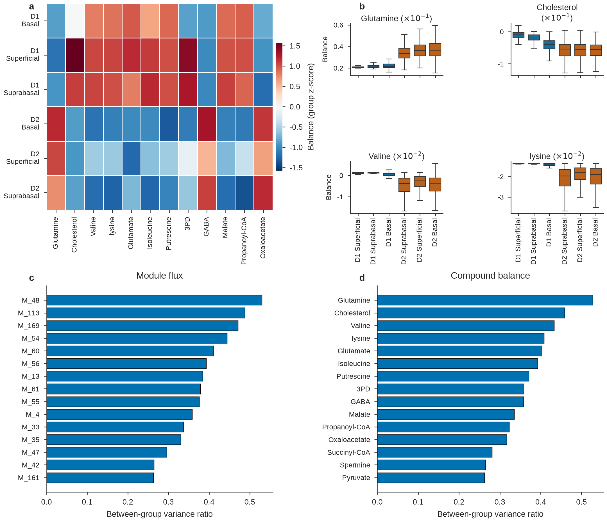
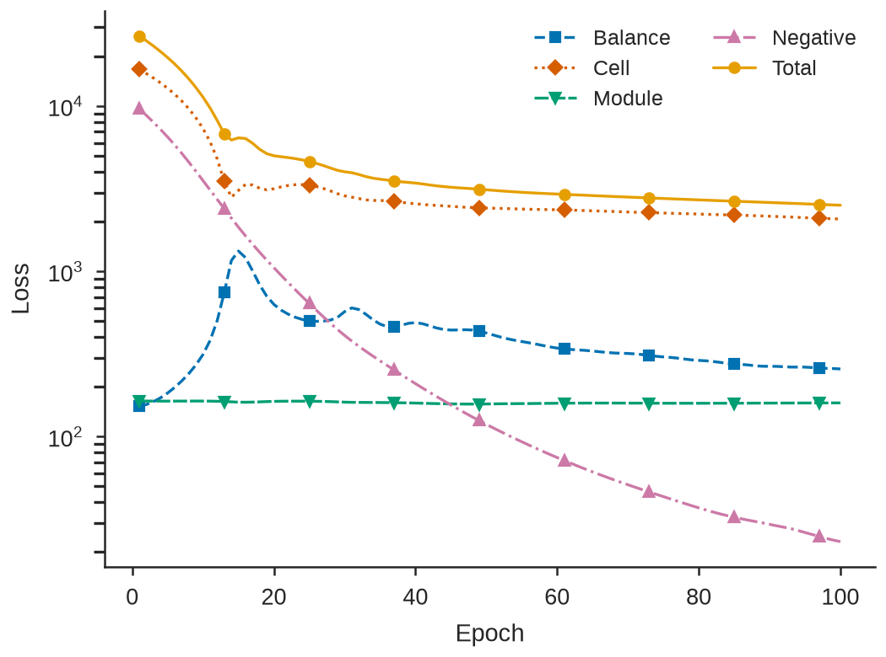
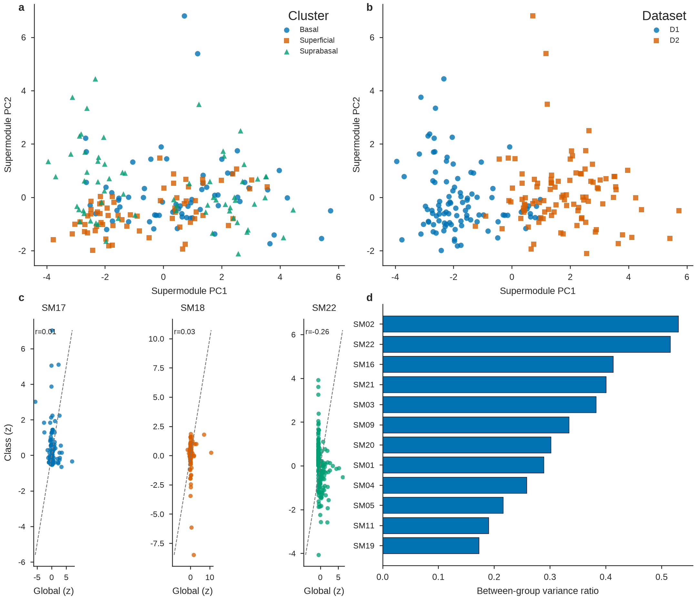

# scFEAann Figure and Table Guide

本文档说明如何使用 `examples/` 中的脚本，以及如何通过 `scFEAann`
绘图和表格 API 从 AnnData 分析结果生成可复现的 SCI 风格图表。

示例图来自仓库中的测试数据：

- `outputs/report_100ep/`：17,492 个细胞、100 epochs 的全局 scFEA 结果；
- `outputs/report_supermodules_1ep/`：200 个细胞、22 个 supermodule
  class、1 epoch 的流程验证结果。

> `report_supermodules_1ep` 用于验证类别、网络和表格流程，不应直接作为最终
> 生物学结论。正式分析应使用充分训练后的全量结果。

---

## 1. 环境准备

从仓库根目录执行：

```bash
uv venv --python 3.12
uv sync --dev
source .venv/bin/activate
```

如果运行环境中的默认 matplotlib cache 不可写，可为命令显式指定缓存：

```bash
export MPLCONFIGDIR=/tmp/matplotlib-cache
```

完整测试：

```bash
.venv/bin/python -m pytest -q
```

---

## 2. `examples/` 使用流程

### 2.0 一键运行全部示例

[examples/run_all_examples.sh](examples/run_all_examples.sh) 会依次运行：

1. 全局 scFEA；
2. 全部 22 个 supermodule 独立模型；
3. SCI 图和表格报告；
4. 预处理、训练和推理 benchmark。

脚本默认使用全部 17,492 个细胞和 100 epochs：

```bash
examples/run_all_examples.sh
```

先检查实际会执行的命令，不创建文件、不开始训练：

```bash
examples/run_all_examples.sh --dry-run
```

小样本端到端验收：

```bash
examples/run_all_examples.sh \
  --output-dir /tmp/scfeaann_examples_smoke \
  --max-cells 10 \
  --epochs 1 \
  --device cpu \
  --benchmark-repeats 1
```

常用参数：

| 参数 | 含义 |
|---|---|
| `--input` | 输入 H5AD |
| `--output-dir` | 总输出目录，默认 `outputs/examples_full_100ep` |
| `--max-cells` | `0` 表示全部细胞 |
| `--epochs` | 全部训练阶段的 epochs，默认 `100` |
| `--device` | `auto`、`cpu` 或 `cuda:0` |
| `--classes` | `all` 或 `1,8` 等 class 选择 |
| `--with-gradient` | 增加逐细胞梯度分析，耗时很高 |
| `--skip-benchmark` | 跳过额外的全局 benchmark 训练 |
| `--resume` | 跳过已有有效产物的阶段 |
| `--dry-run` | 仅打印命令 |

默认流程生成：

```text
outputs/examples_full_100ep/
├── global_scfeaann.h5ad
├── supermodule_scfeaann.h5ad
├── benchmark.json
├── environment.txt
├── run_summary.tsv
├── logs/
│   ├── global.log
│   ├── supermodules.log
│   ├── report.log
│   └── benchmark.log
└── report/
    ├── report_manifest.json
    ├── report_tables.xlsx
    └── Fig*.pdf / .svg / .png
```

任一步骤或任一 supermodule class 失败时，脚本会返回非零状态，并在
`run_summary.tsv` 中记录失败阶段。`--classes` 只选择部分类别时，因为其余
class 槽位按设计为 `NaN`，报告阶段会自动改为读取全局结果；只有
`--classes all` 才从完整 supermodule 结果作图。

### 2.1 全局 scFEA：flux、balance 和可选梯度

脚本：

```text
examples/scfeaann_testdata_flow.py
```

输入必须是带基因表达矩阵的 AnnData H5AD，默认使用 `adata.X`。脚本会：

1. 保留 `obs["dataset"]` 和 `obs["cluster"]`；
2. 创建嵌套分组列 `obs["dataset_cluster"]`；
3. 可选按 `dataset × cluster` 做确定性分层抽样；
4. 对所有选中细胞训练一个全局模型；
5. 可选计算逐细胞梯度；
6. 保存新 H5AD。

先进行 200 细胞冒烟测试：

```bash
MPLCONFIGDIR=/tmp/matplotlib-cache \
.venv/bin/python examples/scfeaann_testdata_flow.py \
  --output outputs/testdata_scfeaann_sample.h5ad \
  --max-cells 200 \
  --epochs 1 \
  --device cpu
```

全量 100 epoch：

```bash
MPLCONFIGDIR=/tmp/matplotlib-cache \
.venv/bin/python examples/scfeaann_testdata_flow.py \
  --output outputs/testdata_scfeaann_full_100ep.h5ad \
  --max-cells 0 \
  --epochs 100 \
  --device auto
```

同时计算梯度：

```bash
.venv/bin/python examples/scfeaann_testdata_flow.py \
  --output outputs/testdata_scfeaann_gradient.h5ad \
  --max-cells 200 \
  --epochs 1 \
  --gradient
```

常用参数：

| 参数 | 含义 |
|---|---|
| `--input` | 输入 H5AD，默认 `testdata/testdata.h5ad` |
| `--output` | 输出 H5AD |
| `--dataset` | 仅使用某个 dataset，例如 `D1` |
| `--max-cells` | `0` 表示全量；正数表示分层抽样 |
| `--epochs` | 训练轮数 |
| `--gradient` | 额外运行梯度分析 |
| `--device` | `auto`、`cpu` 或 `cuda:0` |
| `--random-state` | 分层抽样随机种子，不影响 scFEA 内部 seed 16 |

全局结果写回：

```text
obsm["scFEA_flux"]
obsm["scFEA_balance"]
obsm["scFEA_grad"]          # 仅 --gradient
uns["scFEAann"]
```

### 2.2 Supermodule 独立子模型

脚本：

```text
examples/scfeaann_supermodule_flow.py
```

运行全局模型和全部 22 个 supermodule 子模型：

```bash
.venv/bin/python examples/scfeaann_supermodule_flow.py \
  --input outputs/testdata_scfeaann_sample.h5ad \
  --output outputs/testdata_scfeaann_supermodules_sample.h5ad \
  --classes all \
  --group-key dataset_cluster \
  --epochs 1 \
  --device cpu \
  --quiet
```

只运行部分 class：

```bash
.venv/bin/python examples/scfeaann_supermodule_flow.py \
  --input input.h5ad \
  --output outputs/selected_supermodules.h5ad \
  --classes "1,8,Glycolysis+TCA cycle" \
  --epochs 100
```

全量正式分析：

```bash
.venv/bin/python examples/scfeaann_supermodule_flow.py \
  --input outputs/testdata_scfeaann_full_100ep.h5ad \
  --output outputs/testdata_scfeaann_supermodules_full_100ep.h5ad \
  --classes all \
  --epochs 100 \
  --device auto
```

常用参数：

| 参数 | 含义 |
|---|---|
| `--input` | 输入 AnnData H5AD |
| `--output` | 输出 H5AD |
| `--classes` | `all` 或逗号分隔的 ID/class name |
| `--group-key` | 仅作为 `obs` 元数据保留，不拆分训练 |
| `--epochs` | 每个子模型的训练轮数 |
| `--stop-on-error` | 任一 class 失败时立即停止 |

Supermodule 结果：

```text
obsm["scFEA_flux"]                     # 全局 168 modules
obsm["scFEA_balance"]                  # 全局 70 compounds
obsm["scFEA_supermodule_flux"]         # class 子模型重新拼回 168 modules
obsm["scFEA_supermodule_balance"]      # 22 × 70，C-order 展平
obsm["scFEA_supermodule_flux_sum"]     # 22 个 class 节点特征
obsm["scFEA_supermodule_flux_mean"]    # 22 个 class 节点特征
```

### 2.3 一键生成完整报告

脚本：

```text
examples/scfeaann_report.py
```

只包含全局 scFEA 结果：

```bash
MPLCONFIGDIR=/tmp/matplotlib-cache \
.venv/bin/python examples/scfeaann_report.py \
  --input outputs/testdata_scfeaann_full_100ep.h5ad \
  --output-dir outputs/report_100ep \
  --embedding-method umap \
  --dpi 300
```

包含 supermodule 结果时：

```bash
MPLCONFIGDIR=/tmp/matplotlib-cache \
.venv/bin/python examples/scfeaann_report.py \
  --input outputs/testdata_scfeaann_supermodules_sample.h5ad \
  --output-dir outputs/report_supermodules_1ep \
  --embedding-method umap \
  --dpi 300
```

报告会自动检测：

```python
"scFEA_supermodule_flux_mean" in adata.obsm
```

若存在 supermodule 结果，则额外生成 Fig. 4、Supplementary Fig. 2、
Fig. 5、Supplementary Fig. 3，以及相应网络和节点表。

常用参数：

| 参数 | 默认值 | 含义 |
|---|---|---|
| `--dataset-key` | `dataset` | `obs` 中 dataset 列 |
| `--cluster-key` | `cluster` | `obs` 中 cluster 列 |
| `--top-n` | `30` | 导出的 top feature 数 |
| `--embedding-method` | `umap` | `umap`、`tsne` 或 `pca` |
| `--dpi` | `300` | PNG 分辨率 |
| `--random-state` | `16` | embedding 随机种子 |

---

## 3. 高层报告 API

### `export_scfeaann_report`

```python
from scFEAann import export_scfeaann_report

manifest = export_scfeaann_report(
    adata,
    output_dir="outputs/report",
    dataset_key="dataset",
    cluster_key="cluster",
    top_n=30,
    embedding_method="umap",
    random_state=16,
    dpi=300,
    network_contrast_key="dataset",
    network_contrast=("D1", "D2"),
)
```

输入：

- `adata: AnnData`
  - 必须包含 `obsm["scFEA_flux"]`
  - 必须包含 `obsm["scFEA_balance"]`
  - 必须包含 `obs[dataset_key]`
  - 必须包含 `obs[cluster_key]`
  - supermodule 图需要 `scFEA_supermodule_flux_mean/sum`
- `output_dir`
- `network_contrast`
  - 可选二元组，例如 `("D1", "D2")`
  - 未提供时自动选择该列排序后的前两个水平

返回：

```python
dict
```

返回的 manifest 包含输入规模、分组、embedding、文件清单、网络统计和软件版本。

输出目录示例：

```text
report/
├── Fig1.pdf / .svg / .png / _grayscale.png
├── Fig2.pdf / .svg / .png / _grayscale.png
├── Fig3.pdf / .svg / .png / _grayscale.png
├── Fig4.pdf / .svg / .png / _grayscale.png
├── Fig5.pdf / .svg / .png / _grayscale.png
├── Supp_Fig_loss.pdf / .svg / .png
├── Supp_Fig2_supermodules.pdf / .svg / .png
├── Supp_Fig3_metabolic_network.pdf / .svg / .png
├── report_tables.xlsx
├── report_manifest.json
├── figure_legends.md
├── cell_flux.csv.gz
├── cell_balance.csv.gz
├── cell_metadata.csv.gz
├── module_annotation.csv
├── supermodule_annotation.csv
├── supermodule_node_features_by_cell.csv.gz
├── supermodule_node_features_by_group.csv
├── network_nodes.csv
├── network_edges.csv
├── network_layout.csv
├── factor_graph_nodes.csv
├── factor_graph_edges.csv
├── factor_graph_layout.csv
└── figure_source_data/
```

不同报告包含的文件取决于 AnnData 中存在的 scFEA 结果。

---

## 4. 图表预览

### Figure 1：样本构成和 module flux 结构


文件：

- [Fig1.pdf](outputs/report_100ep/Fig1.pdf)
- [Fig1.svg](outputs/report_100ep/Fig1.svg)
- [Fig1.png](outputs/report_100ep/Fig1.png)
- [Fig1_grayscale.png](outputs/report_100ep/Fig1_grayscale.png)

内容：

- 细胞数；
- 两个 dataset 的 cluster centroid 一致性；
- top module flux 热图；
- top module 分布。

### Figure 2：compound balance



包含 compound balance 热图、top compound 分布、module/compound effect ranking。

### Figure 3：transcriptome 和 flux embedding


使用相同 cell 顺序对照转录组 embedding 与 flux embedding，并分别按
cluster 和 dataset 着色。

### Supplementary Figure：训练损失



展示 total、balance、negative、cell 和 module loss。

### Figure 4：Supermodule class 结果


包含：

- 22 个 supermodule × dataset-cluster 组均值热图；
- top class 的 cell-level 分布；
- 22×22 Spearman 相关矩阵；
- class-specific 与全局聚合结果的一致性。

### Supplementary Figure 2：Supermodule feature embedding



### Figure 5：Supermodule network


- 节点：22 个 supermodule class；
- 边：共享注释代谢物；
- 节点大小：class 内 module 数；
- 左图：拓扑聚类；
- 右图：指定 contrast 的连续 flux effect。

### Supplementary Figure 3：完整 metabolic factor graph


- module 为绿色菱形；
- compound 为粉色圆形；
- 节点内部标注 module ID 或 KEGG ID；
- 蓝色外围文字是 supermodule class 注释；
- 完整 compound name 和网络边导出到 CSV。

---

## 5. 单独绘图 API

### 5.1 先提取报告对象

```python
from scFEAann.reporting import (
    extract_report_results,
    get_transcriptome_embedding,
    compute_flux_embedding,
    build_figure_source_data,
)

report = extract_report_results(
    adata,
    dataset_key="dataset",
    cluster_key="cluster",
    top_n=30,
)

transcriptome_xy, transcriptome_meta = get_transcriptome_embedding(adata)
flux_xy, flux_meta = compute_flux_embedding(
    adata.obsm["scFEA_flux"].to_numpy()
    if hasattr(adata.obsm["scFEA_flux"], "to_numpy")
    else adata.obsm["scFEA_flux"],
    method="umap",
)

source_data = build_figure_source_data(
    report,
    transcriptome_embedding=transcriptome_xy,
    flux_embedding=flux_xy,
)
```

#### `extract_report_results`

```python
report = extract_report_results(
    adata,
    *,
    dataset_key="dataset",
    cluster_key="cluster",
    top_n=30,
) -> ReportResults
```

主要属性：

| 属性 | 类型 | 含义 |
|---|---|---|
| `metadata` | `DataFrame` | cell ID、dataset、cluster、nested group |
| `flux` | `DataFrame` | cells × modules |
| `balance` | `DataFrame` | cells × compounds |
| `group_counts` | `DataFrame` | 每组细胞数 |
| `module_summary` | `DataFrame` | module 分组统计 |
| `compound_summary` | `DataFrame` | compound 分组统计 |
| `module_effects` | `DataFrame` | module effect ranking |
| `compound_effects` | `DataFrame` | compound effect ranking |
| `dataset_consistency` | `DataFrame` | dataset 间 centroid 一致性 |
| `module_annotation` | `DataFrame` | module 注释 |

#### `get_transcriptome_embedding`

```python
coordinates, metadata = get_transcriptome_embedding(adata)
```

优先使用：

1. `obsm["X_umap"]`
2. `obsm["X_tsne"]`
3. 从表达矩阵计算 PCA

返回：

- `coordinates`: `n_obs × 2`
- `metadata`: 实际使用的方法和 fallback 信息

#### `compute_flux_embedding`

```python
coordinates, metadata = compute_flux_embedding(
    flux_array,
    method="umap",
    random_state=16,
)
```

支持 `umap`、`tsne`、`pca`。UMAP/t-SNE 失败时回退到 PCA，并在 metadata 中记录原因。

### 5.2 Figure 1–3 和 loss 图

```python
from scFEAann.reporting import (
    plot_figure1,
    plot_figure2,
    plot_figure3,
    plot_loss_history,
)

plot_figure1(report, source_data, "outputs/figures")
plot_figure2(report, source_data, "outputs/figures")
plot_figure3(report, source_data, "outputs/figures")
plot_loss_history(report, source_data, "outputs/figures")
```

| 函数 | 输入 | 输出 |
|---|---|---|
| `plot_figure1(report, source_data, output_dir, dpi=300)` | 全局 report、source data | `list[Path]` |
| `plot_figure2(...)` | 同上 | `list[Path]` |
| `plot_figure3(...)` | 同上 | `list[Path]` |
| `plot_loss_history(...)` | 同上 | `list[Path]` |

每个函数写出 PDF、SVG、PNG 和 grayscale PNG。

### 5.3 Supermodule 图

```python
from scFEAann.reporting import (
    extract_supermodule_report,
    plot_figure4_supermodules,
    plot_supp_supermodule_embedding,
)

supermodule_report = extract_supermodule_report(adata)

plot_figure4_supermodules(supermodule_report, "outputs/figures")
plot_supp_supermodule_embedding(supermodule_report, "outputs/figures")
```

`extract_supermodule_report` 要求：

```text
obsm["scFEA_supermodule_flux_mean"]
obsm["scFEA_supermodule_flux_sum"]
uns["scFEAann"]["supermodules"]
obs["dataset"]
obs["cluster"]
```

返回 `SupermoduleReport`，包括：

- `node_mean`、`node_sum`
- `group_summary`
- `effects`
- `agreement`
- `correlation`
- `class_annotation`
- `embedding`
- `source_data`

### 5.4 网络图

#### 构建 22-class 网络

```python
from scFEAann.reporting import build_supermodule_network

network = build_supermodule_network(
    adata,
    contrast_key="dataset",
    contrast=("D1", "D2"),
)
```

返回：

- `network.graph`
- `network.nodes`
- `network.edges`
- `network.layout`
- 对比组信息

#### 构建完整 factor graph

```python
from scFEAann.reporting import build_factor_graph

factor_graph = build_factor_graph()
```

拓扑来自模型注释，不需要 AnnData。

#### 绘图和导出

```python
from scFEAann.reporting import (
    plot_supermodule_network,
    plot_factor_graph,
    write_network_tables,
)

plot_supermodule_network(network, "outputs/network")
plot_factor_graph(factor_graph, "outputs/network")
write_network_tables(network, factor_graph, "outputs/network")
```

输出：

```text
Fig5.pdf / .svg / .png / _grayscale.png
Supp_Fig3_metabolic_network.pdf / .svg / .png / _grayscale.png
network_nodes.csv
network_edges.csv
network_layout.csv
network_supermodule_summary.csv
factor_graph_nodes.csv
factor_graph_edges.csv
factor_graph_layout.csv
factor_graph_supermodule_labels.csv
```

---

## 6. 表格导出 API

### `write_summary_tables`

```python
summary_paths = write_summary_tables(report, output_dir)
```

输出 `report_tables.xlsx` 和可用的 `module_annotation.csv`。

### `write_cell_tables`

```python
cell_paths = write_cell_tables(report, output_dir)
```

输出：

```text
cell_metadata.csv.gz
cell_flux.csv.gz
cell_balance.csv.gz
```

### `write_supermodule_tables`

```python
supermodule_paths = write_supermodule_tables(
    supermodule_report,
    output_dir,
)
```

它会：

- 向已有 workbook 追加 supermodule sheets；
- 写 per-cell 和 per-group 节点表；
- 写 supermodule annotation 和 correlation；
- 写 Figure 4、Supplementary Figure 2 的 source data。

### `build_figure_source_data` / `write_figure_source_data`

```python
source_data = build_figure_source_data(
    report,
    transcriptome_embedding=transcriptome_xy,
    flux_embedding=flux_xy,
)

paths = write_figure_source_data(source_data, output_dir)
```

返回字典：

```python
{
    "Fig1a_group_counts": Path,
    "Fig1b_dataset_consistency": Path,
    ...
}
```

### `export_figure`

```python
from scFEAann.reporting import export_figure

paths = export_figure(
    fig,
    "outputs/figures/custom",
    size_inches=(7.2, 4.0),
    formats=("pdf", "svg", "png"),
    dpi=300,
)
```

输入：

- matplotlib `Figure`
- 输出 basename
- 最终尺寸
- 格式列表
- dpi

返回所有生成文件的 `list[Path]`。

---

## 7. Workbook 内容

### 全局结果 sheets

| Sheet | 行规模示例 | 内容 |
|---|---:|---|
| `group_counts` | 6 | dataset × cluster 细胞数 |
| `dataset_consistency` | 3 | cluster 内 dataset centroid 一致性 |
| `module_group_summary` | 1008 | 每组每 module 的统计量 |
| `compound_group_summary` | 420 | 每组每 compound 的统计量 |
| `module_variance_ranking` | 168 | module effect ranking |
| `compound_variance_ranking` | 70 | compound effect ranking |
| `loss_history` | 500 | 5 类 loss × 100 epochs |
| `module_annotation` | 168 | reaction、KEGG IDs、genes、supermodule |

### Supermodule sheets

| Sheet | 内容 |
|---|---|
| `supermodule_group_summary` | class × group × mean/sum 统计 |
| `supermodule_effects` | class-level effect ranking |
| `supermodule_model_agreement` | class model 与全局模型聚合的一致性 |
| `supermodule_correlation` | 22×22 class 相关矩阵 |
| `supermodule_annotation` | module IDs、genes、历史/当前计数 |

---

## 8. 表格展示示例

### Group counts

| dataset | cluster | n_cells |
|---|---|---:|
| D1 | corneal basal epithelium | 3954 |
| D1 | corneal superficial epithelium | 6246 |
| D1 | corneal suprabasal epithelial cells | 1800 |
| D2 | corneal basal epithelium | 2876 |
| D2 | corneal superficial epithelium | 1106 |
| D2 | corneal suprabasal epithelial cells | 1510 |

完整文件：

- [报告工作簿](outputs/report_100ep/report_tables.xlsx)
- [Fig1a source data](outputs/report_100ep/figure_source_data/Fig1a_group_counts.csv)

### Dataset consistency

| cluster | n_cells_a | n_cells_b | Pearson r | Spearman rho |
|---|---:|---:|---:|---:|
| Basal | 3954 | 2876 | 0.9353 | 0.9402 |
| Superficial | 6246 | 1106 | 0.8442 | 0.9426 |
| Suprabasal | 1800 | 1510 | 0.8299 | 0.9303 |

### Top module effects

| module | reaction | effect ratio |
|---|---|---:|
| M_48 | Glutamate -> Glutamine | 0.530 |
| M_113 | Acetyl-CoA -> (E,E)-Farnesyl-PP | 0.488 |
| M_169 | Cholesterol -> Steroid_hormone | 0.471 |
| M_54 | Valine -> Succinyl-CoA | 0.444 |
| M_60 | lysine -> Acetyl-CoA | 0.411 |

完整的 reaction、KEGG ID、基因和 supermodule 注释见：

- [module_annotation.csv](outputs/report_100ep/module_annotation.csv)

### Supermodule effects

| SM ID | Supermodule class | effect ratio |
|---:|---|---:|
| 2 | Serine metabolism | 0.530 |
| 22 | Steroid hormone synthesis | 0.516 |
| 16 | N-linked glycan synthesis | 0.413 |
| 21 | Pyrimidine synthesis | 0.400 |
| 3 | Pentose phosphate | 0.383 |

### Model agreement

| SM ID | class | Pearson r | Spearman rho | RMSE |
|---:|---|---:|---:|---:|
| 1 | Glycolysis+TCA cycle | 1.000 | 1.000 | ~0 |
| 2 | Serine metabolism | 0.683 | 0.796 | 0.00330 |
| 3 | Pentose phosphate | 0.486 | 0.625 | 0.0000014 |
| 4 | Fatty acids metabolism/synthesis | 0.682 | 0.737 | 0.000110 |

这些值来自 1-epoch supermodule 流程示例，仅供验证，不作为最终结论。

---

## 9. 单细胞结果读取 API

### Flux 与 balance

```python
flux = adata.obsm["scFEA_flux"]
balance = adata.obsm["scFEA_balance"]
```

### 梯度

```python
from scFEAann import get_scfeaann_gradient

one_cell = get_scfeaann_gradient(adata, cell="cell_001")
all_cells = get_scfeaann_gradient(adata)
```

### Supermodule 结果

```python
from scFEAann import (
    get_scfeaann_supermodule_flux,
    get_scfeaann_supermodule_balance,
)

class8_flux = get_scfeaann_supermodule_flux(adata, class_id=8)
class8_balance = get_scfeaann_supermodule_balance(adata, class_id=8)
```

### Module 注释

```python
from scFEAann import get_module_annotation

annotation = get_module_annotation()
print(annotation.loc["M_48", ["reaction", "module_genes"]])
```

---

## 10. 统计和解释注意事项

- 图中不报告 cell-level p 值。细胞不是独立的生物学重复。
- effect ratio 是描述性统计，不是显著性检验。
- heatmap 展示 group-level z-score；原始组均值在 workbook 中。
- `flux_mean` 是主比较指标；`flux_sum` 保留给表格和 network 节点。
- 四个单 module supermodule（3、14、15、19）关闭了不可定义的
  module-correlation loss。
- Supermodule 子模型与全局模型是独立训练结果，不应假设数值相同。
- 梯度遵循原 scFEA 的归一化方式，可出现大量 NaN。

---

## 11. 常见问题

### 报告没有 Fig. 4 或 Fig. 5

检查：

```python
"scFEA_supermodule_flux_mean" in adata.obsm
"scFEA_supermodule_flux_sum" in adata.obsm
```

缺少时先运行 `run_scfeaann_supermodules()`。

### 网络 contrast 报错

指定列和组必须存在：

```python
adata.obs["dataset"].unique()
```

并确保 `network_contrast=("A", "B")` 中的两个值都存在。

### Magic cache 或字体错误

```bash
export MPLCONFIGDIR=/tmp/matplotlib-cache
```

### 不要使用 1-epoch 结果做最终生物学解释

使用 `--epochs 100` 或与原 scFEA 一致的收敛设置重新生成最终 H5AD。

---

## 12. 推荐工作流

```text
1. 使用 examples/scfeaann_testdata_flow.py 生成全局结果
2. 使用 examples/scfeaann_supermodule_flow.py 生成 class 子模型
3. 使用 examples/scfeaann_report.py 生成图、表格、source data 和 manifest
4. 检查 figure_legends.md
5. 用 report_manifest.json 核对输入、参数和文件清单
6. 将 H5AD、report_tables.xlsx、PDF/SVG 和 source data 一并归档
```
